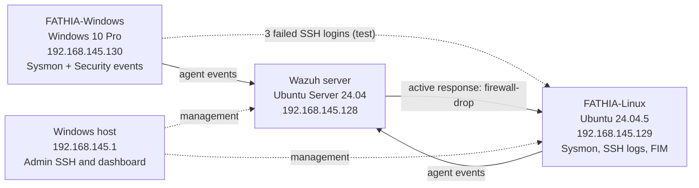
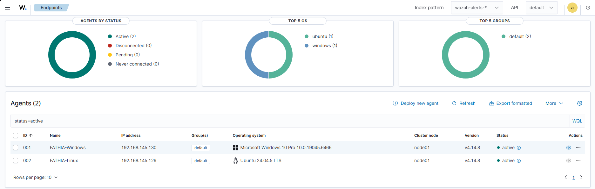
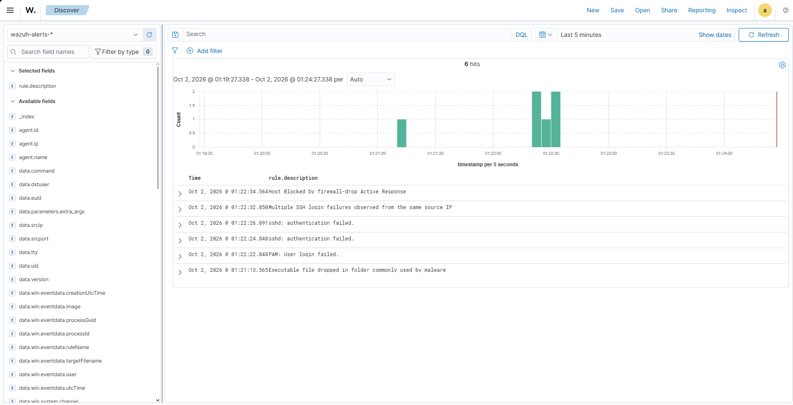
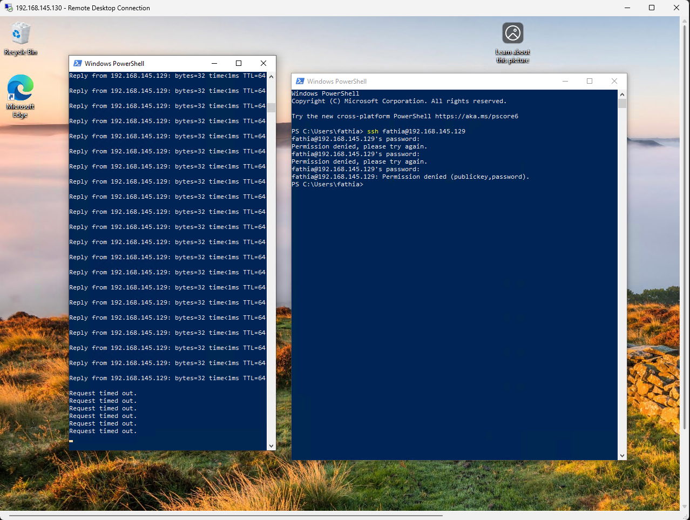
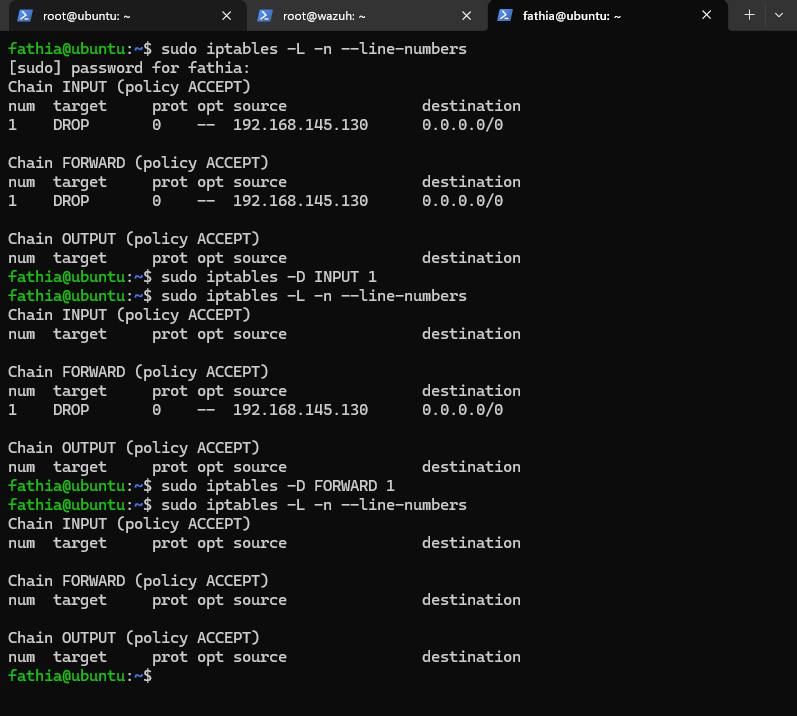
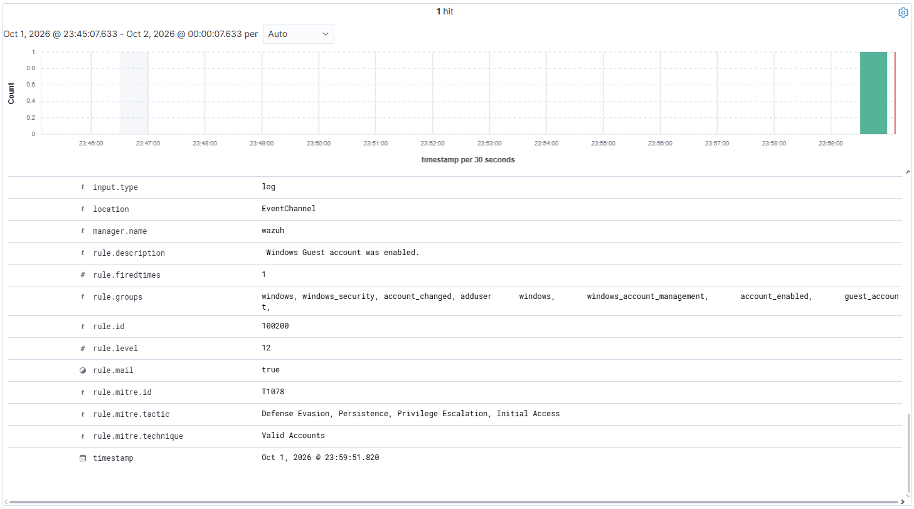
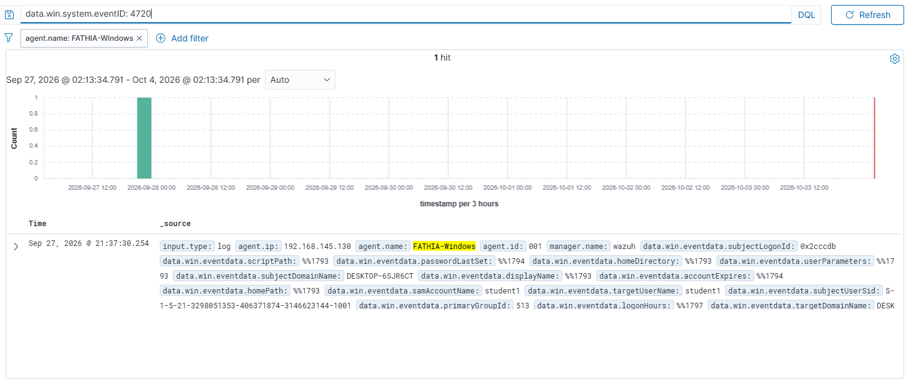
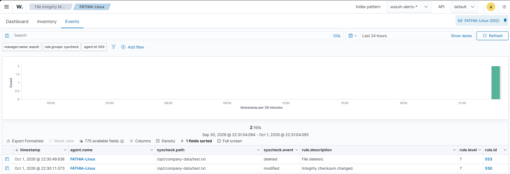
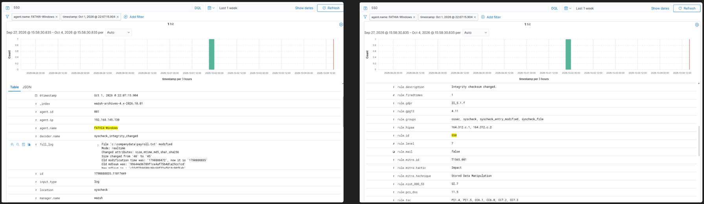
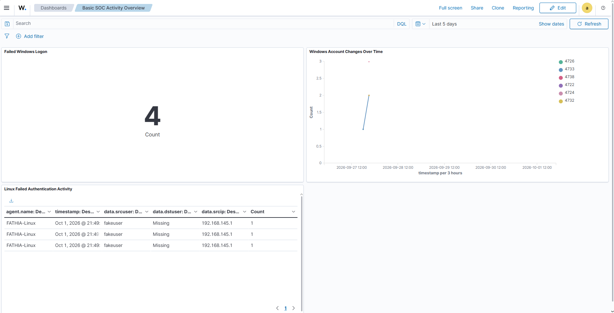

# Wazuh SOC Lab: Detection, Automated Response, and Rule Review

A small SIEM lab built with Wazuh. Two monitored endpoints (Windows 10 and Ubuntu) send telemetry to a Wazuh server. I used it to write and debug custom detections, contain an SSH brute force automatically, triage the resulting alert, and then review my own rules the way a detection engineer would review someone else's.

The build follows the MyDFIR Wazuh SOC Analyst Challenge, in an authorized local VMware lab. The parts below that go beyond the challenge are mine:

- **A correlation rule with automated containment.** Rule 100101 ties repeated SSH failures to one source and triggers `firewall-drop`. I measured the response at about 1.7 seconds.
- **A debugged AI-drafted rule.** The Guest account rule did not fire until I traced its parent rule and fixed the field name, groups, and `if_sid`.
- **An alert triage write-up** for the brute-force case: timeline, scope, verdict, containment, and recovery.
- **A post-lab review** of my own rules: overlap with a built-in rule, threshold trade-offs, a missing allowlist that would have blocked my own management host, and a formatting bug visible in the alert data.

**Skills shown:** SIEM deployment, Windows and Linux log sources, custom correlation rules, active response, file integrity monitoring, MITRE ATT&CK mapping, alert triage, detection tuning.

## 1. Objective

Follow activity end to end: generate it on an endpoint, collect the telemetry, detect it, investigate the alert, validate an automated containment action, and then question whether the detection is good enough for a real environment.

## 2. Architecture



*All three VMs run on VMware Workstation Pro 26H1 in one NAT network (192.168.145.0/24). The host reaches them from the VMware adapter at 192.168.145.1, which matters for the allowlist finding in section 8.*



*Both endpoints active with Wazuh agent 4.14.8.*

## 3. Tools and Versions

| Component | Version | Role |
|---|---|---|
| VMware Workstation Pro | 26H1 | Hypervisor, NAT network |
| Wazuh server | 4.14 on Ubuntu Server 24.04 (2 CPU, 8 GB RAM, 100 GB disk) | Manager, indexer, dashboard, Filebeat, active response. Archives enabled |
| Windows endpoint | Windows 10 Pro, build 19045.6466 (4 GB RAM, 60 GB disk) | Security events, Sysmon, FIM, source of the SSH test |
| Ubuntu endpoint | Ubuntu 24.04.5 LTS (2 CPU, 4 GB RAM, 50 GB disk) | SSH logs, Sysmon for Linux, FIM, target of the SSH test |
| Wazuh agents | 4.14.8 | Telemetry on both endpoints |
| Sysmon | Olaf Hartong config (Windows), collect-all config (Linux, via syslog) | Detailed endpoint telemetry |

## 4. Detections at a Glance

| Activity | Log source | Detection | MITRE ATT&CK | Result |
|---|---|---|---|---|
| Local account `student1` created, added to Administrators, deleted | Windows Security 4720, 4732, 4726 | Built-in Windows rules <!-- TODO: add the rule IDs from the alerts if you still have them --> | T1136.001 Create Account: Local Account, T1098 Account Manipulation (my mapping) | All three events collected. Event 4732 named the new member only by SID, which I resolved to `student1` |
| Failed Windows logons | Windows Security 4625 | Built-in rules | T1110 Brute Force (my mapping) | 4 failures counted on the dashboard. Visibility only: no correlation rule (see section 8) |
| Guest account enabled | Windows Security 4722 | **Custom rule 100200**, level 12 | T1078 Valid Accounts | Fired after I fixed the AI-drafted first version (section 6) |
| Repeated failed SSH logins | Ubuntu sshd logs | **Custom rule 100101**, level 10, correlates built-in rule 5760 | T1110 Brute Force | Fired on the third failure from one source IP, about 10 s after the first |
| Automatic block of the source | Wazuh active response | `firewall-drop`, triggered by rule 100101 | Response action | Block reported 1.7 s after the alert. Ping timed out, iptables showed DROP on INPUT and FORWARD |
| File modified and deleted | Wazuh FIM, real time, on both endpoints | Built-in rules 550 and 553, level 7 | T1565.001 on rule 550 (Wazuh's mapping) | Modification and deletion verified on both endpoints |

## 5. Featured Case: SSH Brute Force with Automatic Block

### Why a custom rule

Wazuh already has a correlation rule for this: built-in **rule 5763** fires on 8 failures of rule 5760 from the same source IP within 120 seconds. Rule 100101 acts earlier, at 3 failures. That fits its job here, which is to trigger an automatic block: a block that waits for 8 attempts lets more guesses through.

The trade-off: 3 failures is also what a real user produces after mistyping a password a few times. My own test used a valid account name (`fathia`). On a real network this threshold would block legitimate users unless it is paired with an allowlist and a block timeout. Section 8 covers both.

```xml
<group name="local,syslog,sshd,authentication_failed,">
  <rule id="100101" level="10" frequency="3" timeframe="120">
    <if_matched_sid>5760</if_matched_sid>
    <same_source_ip />
    <description>Multiple SSH login failures observed from the same source IP</description>
    <mitre>
      <id>T1110</id>
    </mitre>
    <group>authentication_failed,ssh_bruteforce,credential_access,</group>
  </rule>
</group>
```

The active response, as tested, on the Wazuh server:

```xml
<active-response>
  <disabled>no</disabled>
  <command>firewall-drop</command>
  <location>local</location>
  <rules_id>100101</rules_id>
</active-response>
```

`location` is `local`, so the block runs on the agent that reported the attack (the Ubuntu VM).

### Timeline

From the Windows VM I made three failed SSH logins as `fathia` against the Ubuntu VM, with a continuous ping running in a second window. Alerts in `wazuh-alerts-*`, Oct 2, 2026:

| Time | Alert | Note |
|---|---|---|
| 01:22:22.848 | PAM: User login failed | First failure, seen by PAM |
| 01:22:24.848 | sshd: authentication failed (5760) | First failure, seen by sshd |
| 01:22:26.891 | sshd: authentication failed (5760) | Second failure |
| 01:22:32.850 | **Multiple SSH login failures observed from the same source IP (100101)** | Third failure. It appears as 100101 and not as 5760 because Wazuh raises one alert per event, at the most specific matching rule |
| 01:22:34.564 | Host Blocked by firewall-drop Active Response | **1.7 s** after the correlation alert |



*The full 5-minute window: the SSH chain, the block, and one unrelated alert at 01:21:13 (see the triage notes).*

<!-- TODO: if you remember what the 01:21:13 "Executable file dropped in folder commonly used by malware" alert was, add one sentence about it below. -->

### Triage notes

- **Alert:** rule 100101, level 10, on agent FATHIA-Linux (192.168.145.129). Source IP 192.168.145.130, target account `fathia` (a valid local user), 3 failures in about 10 seconds.
- **Did the attacker get in?** No. There is no authentication-success alert from that source in the window, and the client ended with `Permission denied (publickey,password)`.
- **Scope:** one source, one target account, one host. The other alert in the window (01:21:13, "Executable file dropped in folder commonly used by malware") came from the Windows event channel, not from SSH. It is not part of this chain, so I left it out of this case.
- **Verdict:** true positive. The activity was my own authorized test.
- **Containment:** automatic. Ping from the Windows VM went from replies to timeouts, and iptables on the Ubuntu VM showed DROP rules for 192.168.145.130 on INPUT and FORWARD.
- **Recovery:** the response had no timeout, so I removed both rules by hand (`iptables -D INPUT 1`, `iptables -D FORWARD 1`) and confirmed the chains were empty.
- **In a real environment** the source is an internal workstation, which changes the question from "who is attacking us" to "is this workstation compromised". Next steps would be to check that host's process and logon activity around 01:22, look for the same source trying other accounts or hosts, and reset the target account's password if anything was suspicious.



*Three denied SSH logins, then ping timeouts from the Windows VM.*



*iptables on the Ubuntu VM: the Windows VM dropped on INPUT and FORWARD, then the manual removal.*

## 6. Debugging an AI-Drafted Rule: Guest Account Enabled

Enabling the built-in Guest account is a quiet way to keep access to a Windows machine, so I wanted a high-severity alert for event 4722 when the target is `Guest`. As the challenge demonstrates, I first drafted the rule with an AI assistant. That version did not fire.

What I fixed, by checking the rule against a real 4722 event and tracing the built-in parent rule:

1. **Field name.** The drafted field did not match the name Wazuh gives the decoded event data. The working rule uses `win.eventdata.targetUserName`.
2. **Parent rule.** A child rule only runs if the event first matches its `if_sid` parent. I set it to 60103, the built-in rule the 4722 event actually passes through.
3. **Rule groups.** I corrected the groups the rule belongs to.

```xml
<group name="windows,windows_security,account_changed,adduser">
  <rule id="100200" level="12">
    <if_sid>60103</if_sid>
    <field name="win.system.eventID">^4722$</field>
    <field name="win.eventdata.targetUserName">^Guest$</field>
    <description> Windows Guest account was enabled.</description>
    <mitre>
      <id>T1078</id>
    </mitre>
    <group>
      windows,
      windows_account_management,
      account_enabled,
      guest_account,
    </group>
  </rule>
</group>
```



*Rule 100200 firing on Oct 1, 2026 at 23:59:51.*

Reviewing the alert again later, I found two things the test did not catch: the multi-line `<group>` block put line breaks and spaces into `rule.groups` (visible in the screenshot), and the description starts with a space. Neither stops the rule from firing, but the first can break any search or dashboard filter on `rule.groups: guest_account`. Both are in the review below.

## 7. Other Telemetry: Account Lifecycle, FIM, Dashboard

**Account lifecycle.** I created a local account `student1`, added it to Administrators, and deleted it. Event 4720 recorded the creation. Event 4732 (member added to a security group) identified the new member only by SID, so I resolved the SID to `student1`. This is a common step when triaging group changes.



*Event 4720 recorded the creation of `student1`.*

**File integrity monitoring.** I enabled real-time FIM on `/opt/company-data` (Linux) and `C:\companydata` (Windows), then modified and deleted test files.



*Linux FIM: `test.txt` modified (550) and deleted (553) in `/opt/company-data`.*



*Windows real-time FIM: modification event (rule 550) in `C:\companydata`.*

**Dashboard.** "Basic SOC Activity Overview" has three panels: failed Windows logons, Windows account changes over time (events 4722, 4724, 4726, 4732, 4733, 4738), and Linux failed authentication.



*The Linux panel shows an earlier test: three failed logins for a nonexistent user `fakeuser` from 192.168.145.1, my host machine. It is separate from the featured test.*

## 8. Post-Lab Detection Review

I reviewed my rules after the lab, as I would review a colleague's before deployment. These changes are **proposed and not yet re-tested**, because the lab is no longer running.

| # | Finding | Risk | Proposed fix |
|---|---|---|---|
| 1 | Rule 100101 duplicates built-in rule 5763 at a lower threshold (3 vs 8) | Two rules alerting on the same activity; analysts must know which one triggers the block | Keep 100101 for containment, and document why it exists (done in section 5) |
| 2 | No `ignore` on rule 100101 | A sustained attack re-fires the rule and the block on every new set of failures | Add `ignore="60"`, as rule 5763 does |
| 3 | No `timeout` on the active response | Blocks are permanent. I had to remove them by hand | Add `<timeout>600</timeout>` so blocks expire after 10 minutes |
| 4 | No allowlist | My host (192.168.145.1) manages both VMs over SSH. The earlier `fakeuser` test came from that address, so with the response enabled, three typos from the host would have locked me out of my own lab | Add the management address to `<white_list>` in the server's `<global>` section |
| 5 | Threshold of 3 also matches normal password typos | Legitimate users blocked | Pair with the timeout and allowlist. In production, tune against real failure rates |
| 6 | Rule 100101 belongs to the `authentication_failed` group | Dashboards counting authentication failures also count the correlation alert | Remove `authentication_failed` from the rule's groups |
| 7 | Rule 100200 group list is split across lines | `rule.groups` values contain line breaks, so filters on `guest_account` can miss the alert | Put the groups on one line. Remove the leading space in the description |
| 8 | Broad MITRE IDs | Less precise reporting | 100101 → T1110.001 Password Guessing. 100200 → T1078.001 Default Accounts |
| 9 | Failed Windows logons are visible but not correlated | A Windows brute force raises only individual events | Add a frequency rule on 4625 by source, similar to 100101 |
| 10 | Sysmon is collected but no custom rule uses it | Sysmon fed built-in alerts (one appears in the SSH timeline), but I did not write or test a Sysmon detection | First rule to add when I rebuild the lab, for example on suspicious process creation (Sysmon Event ID 1) |

Proposed version of the SSH rule and response (findings 2, 3, 4, 6, 8):

```xml
<!-- local_rules.xml -->
<group name="local,syslog,sshd,">
  <rule id="100101" level="10" frequency="3" timeframe="120" ignore="60">
    <if_matched_sid>5760</if_matched_sid>
    <same_source_ip />
    <description>sshd: 3 authentication failures from the same source IP within 120 seconds</description>
    <mitre>
      <id>T1110.001</id>
    </mitre>
    <group>ssh_bruteforce,credential_access,</group>
  </rule>
</group>

<!-- ossec.conf on the Wazuh server -->
<global>
  <white_list>192.168.145.1</white_list>
</global>

<active-response>
  <disabled>no</disabled>
  <command>firewall-drop</command>
  <location>local</location>
  <rules_id>100101</rules_id>
  <timeout>600</timeout>
</active-response>
```

## 9. Build and Configuration

- Deployed Wazuh 4.14 (manager, indexer, dashboard, Filebeat) on an Ubuntu Server VM and enabled archives, so every event is searchable, not just alerts.
- Enrolled the Windows and Ubuntu endpoints as agents and installed Sysmon on both.
- Enabled real-time FIM on `C:\companydata` (Windows) and `/opt/company-data` (Linux).
- Built the three-panel dashboard.
- Wrote custom rules 100200 and 100101 and linked rule 100101 to `firewall-drop`.

The rules as tested are in [`rules/local_rules.xml`](rules/local_rules.xml), and the configuration excerpts in [`rules/config-snippets.md`](rules/config-snippets.md).

## 10. Lessons Learned and Limitations

**AI-drafted detections are a starting point.** The Guest account rule looked correct, but it did not fire. What fixed it was checking a real event and the parent rule it depends on, not rereading the rule.

**A rule that fires is not finished.** Both custom rules worked in testing, and both still had problems that only showed up when I looked at the alert data and asked how they would behave on a real network.

**Limitations:**

- One Wazuh server, two endpoints, and a handful of simulated events. The rules were never measured against normal traffic, so false-positive rates are unknown.
- Lab credentials were handled in plain text, which is not acceptable in production. <!-- TODO: say what this was, e.g. passwords kept in a notes file, and what you would use instead. -->
- Windows 10 reached end of support in October 2025. A production endpoint would run a supported version.
- The proposed fixes in section 8 are not yet re-tested.

## 11. Attribution

Built from the [MyDFIR Wazuh SOC Analyst Challenge](https://www.youtube.com/playlist?list=PLR6URv8tFDJE).

| From the challenge | My own work |
|---|---|
| Step-by-step build of the Wazuh stack and agents | Running the lab, all tests, and all evidence shown here |
| Sysmon configurations (Olaf Hartong for Windows, collect-all for Linux) | Debugging the Guest account rule until it fired |
| Demonstration of drafting rules with AI | Correlation rule 100101 and its link to the active response |
| | Alert timeline, triage notes, and the post-lab detection review |

All testing was done in my own authorized lab. My rules, configuration excerpts, and documentation are under the [MIT License](LICENSE). MyDFIR and other third-party content remain the property of their owners.
