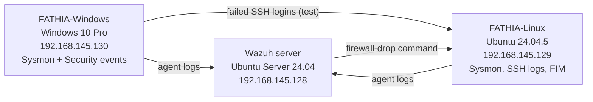

# Wazuh SOC Lab: Detection and Automated Response

A small SIEM lab built with Wazuh. Two monitored endpoints (Windows 10 and Ubuntu) send telemetry to a Wazuh server, where I tested built-in and custom detections, file integrity monitoring (FIM), a dashboard, and an active response that automatically blocks the source of repeated failed SSH logins.

Built from the MyDFIR Wazuh SOC Analyst Challenge, in an authorized local VMware lab.

## 1. Objective

Follow activity end to end: generate it on an endpoint, collect the telemetry, detect it, investigate the alert, and validate an automated containment action.

## 2. Architecture



*All three VMs run on VMware Workstation Pro 26H1 on a Windows host, in one NAT network (192.168.145.0/24).*


*Both endpoints active with Wazuh agent 4.14.8.*

## 3. Tools and Versions

| Component | Version | Role |
|---|---|---|
| VMware Workstation Pro | 26H1 | Hypervisor, NAT network |
| Wazuh server | 4.14 on Ubuntu Server 24.04 (2 CPU, 8 GB RAM, 100 GB disk) | Manager, indexer, dashboard, Filebeat, active response. Archives enabled |
| Windows endpoint | Windows 10 Pro, build 19045.6466 (4 GB RAM, 60 GB disk) | Security events, Sysmon, FIM, source of the SSH test. Accessed over RDP |
| Ubuntu endpoint | Ubuntu 24.04.5 LTS (2 CPU, 4 GB RAM, 50 GB disk) | SSH logs, Sysmon for Linux, FIM, target of the SSH test |
| Wazuh agents | 4.14.8 | Telemetry on both endpoints |
| Sysmon | Olaf Hartong config (Windows), collect-all config (Linux, via syslog) | Detailed endpoint telemetry |

## 4. Detections at a Glance

| Activity | Log source | Wazuh rule / level | MITRE ATT&CK | Result |
|---|---|---|---|---|
| Local account created, added to Administrators, deleted | Windows Security 4720, 4732, 4726 | Built-in | T1136.001 (my mapping) | Creation of `student1` recorded. The group-add event listed the member only by SID, which I resolved to `student1` |
| Failed Windows logons | Windows Security 4625 | Built-in | n/a | 4 events shown in the dashboard |
| Guest account enabled | Windows Security 4722 | Custom rule 100200 / level 12 | T1078 Valid Accounts | Alert fired after I fixed the first draft |
| Repeated failed SSH logins | Ubuntu SSH auth log | Custom rule 100101 / level 10 (built on rule 5760) | T1110 Brute Force | Fires on 3 failures within 120 s from one source IP |
| Automatic block of the source | Wazuh active response | Triggered by rule 100101 | n/a | "Host Blocked by firewall-drop Active Response" alert, ping timeouts, iptables DROP |
| File modified and deleted | Wazuh FIM on both endpoints | Rules 550 and 553 / level 7 | T1565.001 (rule 550) | Both events verified on Linux and Windows |


*Custom rule 100200 detected the Windows Guest account being enabled.*


*Event 4720 recorded the creation of the local account `student1`.*


*Linux FIM: file modified (550) and file deleted (553) in `/opt/company-data`.*


*Windows real-time FIM: modification event (rule 550) in `C:\companydata`.*

## 5. Featured Detection: SSH Brute Force with Automatic Block

From the Windows VM (192.168.145.130) I made three failed SSH logins against the Ubuntu VM (192.168.145.129). The built-in rules alert on each individual failure (for example "sshd: authentication failed"), but none of them ties the failures to one source. Custom rule 100101 does: it fires on three failures within 120 seconds from the same source IP.

```xml
<group name="local,syslog,sshd,authentication_failed,">
  <rule id="100101" level="10" frequency="3" timeframe="120">
    <if_matched_sid>5760</if_matched_sid>
    <same_source_ip />
    <description>Multiple SSH login failures observed from the same source IP</description>
    <mitre>
      <id>T1110</id>
    </mitre>
    <group>authentication_failed,ssh_bruteforce,credential_access,</group>
  </rule>
</group>
```

I linked rule 100101 to the `firewall-drop` active response, which runs locally on the Ubuntu agent. About two seconds after the correlation alert, Wazuh reported the block. Pings from the Windows VM changed from replies to timeouts, and iptables showed DROP rules for the Windows VM on INPUT and FORWARD. I removed them manually afterwards.


*Rule 100101 fires, then Wazuh reports the host blocked.*


*Three denied SSH logins, then ping timeouts from the Windows VM.*


*iptables on the Ubuntu VM: the Windows VM is dropped on INPUT and FORWARD.*

## 6. Build and Configuration

- Deployed Wazuh 4.14 (manager, indexer, dashboard, Filebeat) on an Ubuntu Server VM and enabled archives, so all events are searchable, not just alerts.
- Enrolled the Windows and Ubuntu endpoints as agents and installed Sysmon on both.
- Enabled real-time FIM on `C:\companydata` (Windows) and `/opt/company-data` (Linux).
- Built a three-panel dashboard, "Basic SOC Activity Overview": failed Windows logons, Windows account changes over time, and Linux failed authentication.
- Wrote custom rules 100200 and 100101, and configured rule 100101 to run `firewall-drop`.


*The dashboard. The Linux authentication panel shows separate earlier tests, not the featured SSH test.*

The rules are in [`rules/local_rules.xml`](rules/local_rules.xml) and the configuration excerpts in [`rules/config-snippets.md`](rules/config-snippets.md).

## 7. Lessons Learned and Limitations

**Lesson:** an AI-drafted rule is only a starting point. My Guest account rule did not fire until I corrected the field name, the rule groups, and the `if_sid` link to the built-in rule it depends on. Testing every rule against real events is what makes it trustworthy.

**Limitations:** this is a small lab with one Wazuh server, two endpoints, and simulated activity only. Credentials were handled in plain text, which is not acceptable in production. The automatic block has no allowlist, so in a real environment it could cut off legitimate traffic.

## 8. Attribution

Built from the [MyDFIR Wazuh SOC Analyst Challenge](https://www.youtube.com/playlist?list=PLR6URv8tFDJE). The challenge provided the step-by-step build and the Sysmon configurations, and it demonstrates drafting rules with AI. I built and ran the lab, tested the rules against real events, fixed the Guest account rule, and documented the results.

All testing was done in my own authorized lab. My rules, configuration excerpts, and documentation are under the [MIT License](LICENSE). MyDFIR and other third-party content remain the property of their owners.
